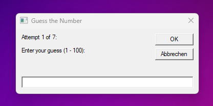

# VBScript Number Guessing Game

A lightweight Windows script game where you guess a random number between 1 and 100 within 7 attempts, featuring higher/lower hints, input validation, and instant replays with zero installation needed.

## Setup & Play
1. Paste the script code into Notepad.
2. Save the file as `GuessingGame.vbs` (set **Save as type** to **All Files (*.*)**).
3. Double-click `GuessingGame.vbs` to launch.
